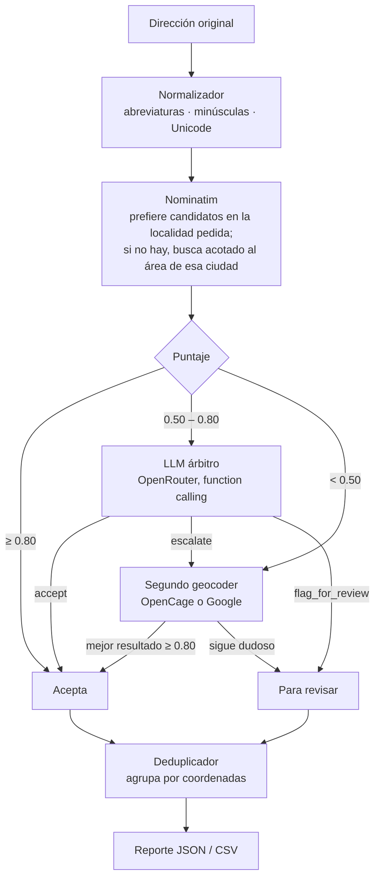

# routetools

Herramientas para preparar rutas de reparto. Primer módulo: **`address_cleaner`**, que toma
una lista de direcciones escritas a mano (abreviadas, con errores, duplicadas) y devuelve
coordenadas confiables, un puntaje de confianza por dirección y la lista de las que necesita
revisar una persona.

## El problema

Una dirección mal geocodificada es una entrega fallida. Los geocoders gratuitos (OpenStreetMap)
fallan con abreviaturas o resuelven calles homónimas en otro pueblo; los pagos son más
precisos pero cuestan por consulta; y revisar todo a mano no escala.

## Enfoque

- **Primero lo determinístico, el LLM solo donde aporta.** Cada resultado recibe un puntaje
  calculado con reglas. Si es alto se acepta, si es bajo se escala a un segundo geocoder.
  El LLM interviene **solo en la zona gris**, donde las reglas no alcanzan para decidir
  (en el ejemplo de abajo, 2 de 14 direcciones).
- **Salida del LLM acotada.** Responde por *function calling* con una de tres decisiones
  (`accept`, `escalate`, `flag_for_review`) y un motivo. La respuesta se valida: si es
  inválida, la dirección pasa a revisión. Puede ajustar el puntaje en ±0.2 como máximo:
  matiza el número, no lo reemplaza.
- **Ante la duda, revisión humana.** Una coordenada equivocada cuesta más que una revisión.
  Lo que no supera el umbral, ni siquiera después de escalar, va a revisión con el motivo.
  Escalar nunca reemplaza un resultado por uno peor.
- **Puntaje calibrado con respuestas reales**, no con supuestos (ver
  [Lo que mostraron los datos](#lo-que-mostraron-los-datos)).
- **Falla de forma predecible.** Sin claves funciona igual, solo con Nominatim, y manda lo
  dudoso a revisión. Si el LLM está saturado (429), reintenta y después deriva a revisión.
  Un timeout no frena el lote. Una clave rechazada sí corta la ejecución, con un mensaje
  claro: es un error de configuración, no una dirección mala.
- **Trazable.** Cada fila del reporte dice de qué fuente salió, con qué puntaje, si intervino
  el LLM y por qué.

## Cómo funciona



## Ejemplo

Corrida real sobre [`examples/direcciones_reparto.csv`](examples/direcciones_reparto.csv),
con Nominatim, OpenCage y `mistral-small-3.2` como árbitro:

```
$ uv run routetools-clean examples/direcciones_reparto.csv
  OK        1.00  C/ Mayor 10, Madrid
  OK        1.00  calle mayor 10 , MADRID
  OK        1.00  Gran Vía 28, Madrid
  OK        1.00  Pº de la Castellana 100, Madrid
  OK        1.00  C/ Sierpes 30, Sevilla
  REVISAR   0.54  Avda. de la Constitución 5, Sevilla
  OK        1.00  c/ Alfonso I 20, Zaragoza
  LLM OK    0.64  Pza. del Pilar s/n, Zaragoza
  OK        1.00  Carrer de Mallorca 401, Barcelona
  REVISAR   0.29  c/ Gran Via 28, Barcelona
  OK        1.00  C/ Colón 1, Valencia
  OK        0.85  Calle Larios 5, Malaga
  REVISAR   0.75  Pol. Industrial Norte, Calle A 12, Burgos
  REVISAR   0.12  Ctra. Nacional II km 15, Guadalajara

14 direcciones · 13 ubicaciones únicas · 4 para revisar · 4 escaladas · 2 con LLM · confianza media 0.80
```

- Las dos formas de escribir `Calle Mayor 10` quedan en la misma ubicación (13 únicas de 14).
- **`Pza. del Pilar s/n`**: una plaza sin número nunca alcanza el puntaje de un portal, así
  que las reglas no pueden decidir. El LLM la aceptó: *"La plaza del Pilar es un lugar
  conocido en Zaragoza y la dirección coincide con la localidad y la plaza mencionada."*
- **`Avda. de la Constitución 5, Sevilla`**: se encontró la avenida pero no el número. El LLM
  pidió escalar (*"El número de la calle no se resolvió correctamente"*). Como OpenCage no
  mejoró el resultado, la dirección quedó para revisión en vez de aceptarse a nivel calle.
- **`Calle A 12, Burgos`**: OpenCage la ubicó en Miranda de Ebro, otra ciudad de la provincia.
  Coincide calle y número, pero no la localidad, así que va a revisión.
- Las otras dos son genuinamente ambiguas: en OpenStreetMap la Gran Via de Barcelona se
  llama "Gran Via de les Corts Catalanes", y una carretera por kilómetro necesita a alguien
  que conozca la zona.

Las dos consultas al LLM costaron fracciones de centavo de dólar.

## Lo que mostraron los datos

El puntaje y las búsquedas se ajustaron mirando respuestas reales de las APIs:

| Observación | Ajuste |
|---|---|
| El `importance` de Nominatim mide qué tan conocido es un lugar, no la precisión: un portal bien resuelto da ~0.0001 | No se usa |
| Los resultados con número suelen ser comercios (`shop`, `hotel`), cuyo tipo no dice nada de la precisión | Un número de portal resuelto define el nivel `house` |
| Para `Calle Mayor 10, Madrid` devuelve tres comercios del mismo edificio | La ambigüedad cuenta ubicaciones distintas (a más de ~100 m), no resultados |
| Lee "Valencia" o "Zaragoza" como la **provincia**: para `C/ Colón 1, Valencia` devuelve Requena, Utiel… y ningún resultado en la ciudad | Se prefiere el candidato en la localidad pedida; si no hay ninguno, se busca acotado al área de esa ciudad |
| La búsqueda estructurada (`street` + `city`) devuelve los mismos pueblos | Descartada |
| Plazas y avenidas peatonales vienen con `place_rank` 25, que parece nivel barrio | Toda vía (`category: highway`) cuenta como calle |
| El modelo gratuito original dejó de existir, y los gratuitos actuales devuelven 429 seguido | Modelo pago y barato por defecto, configurable |
| Los modelos que razonan antes de responder gastaban los 256 tokens antes de llamar a la función | `max_tokens` = 1024 |

## Instalación

Requiere Python 3.11+ y [uv](https://docs.astral.sh/uv/).

```bash
git clone https://github.com/EtaCarinae/routingtools.git
cd routingtools
uv sync --extra dev
```

## Configuración

```bash
cp .env.example .env
```

| Variable | Para qué | Obligatoria |
|---|---|---|
| `NOMINATIM_USER_AGENT` | Identificarte ante OpenStreetMap con un email o la URL de tu proyecto. No es una API key: Nominatim no usa ([política de uso](https://operations.osmfoundation.org/policies/nominatim/)) | Sí |
| `OPENROUTER_API_KEY` | LLM árbitro ([openrouter.ai](https://openrouter.ai) → Keys) | No |
| `OPENCAGE_API_KEY` | Segundo geocoder ([opencagedata.com](https://opencagedata.com/users/sign_up); 2.500 consultas/día gratis) | No |
| `GOOGLE_MAPS_API_KEY` | Segundo geocoder alternativo, con `escalation_provider: google` | No |

Sin las claves opcionales, las direcciones que habrían ido al LLM o al segundo geocoder se
marcan para revisión.

Los umbrales, el modelo del LLM, el geocoder de escalada y las abreviaturas se ajustan en
[`config/settings.yaml`](config/settings.yaml).

## Uso

### Desde la terminal

```bash
uv run routetools-clean direcciones.csv
uv run routetools-clean direcciones.csv --column direccion --output-dir salida --format csv
```

El CSV necesita una columna con la dirección (por defecto `address`).

### Desde Python

```python
import asyncio

from routetools.address_cleaner.ingestion.csv_ingester import CsvIngester
from routetools.address_cleaner.pipeline import AddressCleanerPipeline
from routetools.address_cleaner.reporter import save_report


async def main():
    pipeline = AddressCleanerPipeline(CsvIngester("direcciones.csv"))
    report = await pipeline.run()
    print(report.summary)
    save_report(report, output_dir="output", formats=["json", "csv"])


asyncio.run(main())
```

Para leer de otra fuente (base de datos, API), implementá `AddressIngester`.

## Reporte

Por cada dirección:

| Campo | Descripción |
|---|---|
| `original` | Dirección tal como vino |
| `pre_normalized` | Tras la normalización de texto |
| `geocode.formatted_address` | Dirección encontrada |
| `geocode.lat` / `lon` | Coordenadas |
| `geocode.locality` | Localidad del resultado |
| `geocode.source` | `nominatim` · `opencage` · `google` · `failed` |
| `geocode.quality_score` | Puntaje de ese resultado |
| `confidence` | Confianza final, incluido el ajuste del LLM |
| `flagged` / `flag_reason` | Si necesita revisión, y por qué |
| `escalated` | Si se consultó el segundo geocoder |
| `arbiter_consulted` / `arbiter_rationale` | Si intervino el LLM, y su motivo |
| `dedupe_cluster_id` | Las direcciones con el mismo ID están en el mismo punto |

Y un resumen: total, para revisar, escaladas, consultas al LLM, fuentes, confianza media y
ubicaciones únicas.

## Puntaje de calidad

| Componente | Peso | Qué mide |
|---|---|---|
| Precisión | 0.40 | portal 1.0 · calle 0.6 · barrio 0.3 · ciudad 0.1 |
| Localidad | 0.25 | 1 si coincide con la del input (sin distinguir tildes), 0 si no, 0.5 si no hay con qué comparar |
| Bounding box | 0.20 | Cuanto más chica el área del resultado, mejor |
| Número de portal | 0.15 | El resultado resolvió el número |
| Ambigüedad | −0.15 | Hay candidatos en la localidad en lugares distintos (a más de ~100 m) |

La localidad esperada es la última parte de la dirección, después de la última coma, si no
tiene números.

## Desarrollo

```bash
uv run ruff check .      # lint
uv run ruff format .     # formato
uv run pytest            # 63 tests; las APIs externas se mockean con respx
```

## Estructura

```
config/settings.yaml               umbrales, modelo, geocoder de escalada, abreviaturas
examples/                          CSV de ejemplo
routetools/address_cleaner/
├── cli.py                         routetools-clean
├── pipeline.py                    orquestación y reglas de decisión
├── normalizer.py                  normalización y localidad esperada
├── deduplicator.py
├── reporter.py                    resumen, JSON y CSV
├── models.py                      tipos Pydantic
├── config.py                      .env + YAML
├── errors.py
├── ingestion/                     AddressIngester + CSV
├── geocoding/
│   ├── base.py                    interfaz y selección de candidatos
│   ├── quality.py                 puntaje
│   ├── nominatim.py               rate limit, búsqueda acotada por ciudad
│   ├── opencage.py
│   └── google.py
└── arbiter/llm_arbiter.py         prompt, function calling, validación, reintentos
tests/address_cleaner/
```

## Datos y atribución

- Los resultados de Nominatim son datos de **© [OpenStreetMap contributors](https://www.openstreetmap.org/copyright)**,
  bajo licencia [ODbL](https://opendatacommons.org/licenses/odbl/). Si publicás o mostrás
  coordenadas obtenidas con esta herramienta, incluí esa atribución.
- El servidor público de Nominatim no usa API key, pero tiene una
  [política de uso](https://operations.osmfoundation.org/policies/nominatim/): User-Agent que
  te identifique (`NOMINATIM_USER_AGENT`, con un email o la URL de tu proyecto), como máximo
  1 consulta por segundo (la herramienta lo respeta) y nada de uso masivo. Para volúmenes
  grandes, levantá tu propia instancia de Nominatim.
- OpenCage y Google tienen sus propios términos; revisalos antes de usar sus resultados.

## Limitaciones y próximos pasos

- Procesa de a una dirección, por el límite de 1 req/s de Nominatim. Para lotes grandes
  conviene un Nominatim propio o paralelizar la escalada.
- Las abreviaturas y la detección de localidad están pensadas para direcciones de España.
- No cachea resultados: reprocesar un archivo vuelve a consultar todo.
- El geocoder de Google está implementado pero no se probó contra la API real.
- Los umbrales se calibraron con pocos casos. El paso siguiente es un set de direcciones
  etiquetadas para medir la precisión de cada etapa y del árbitro, y ajustar los umbrales
  con datos.
